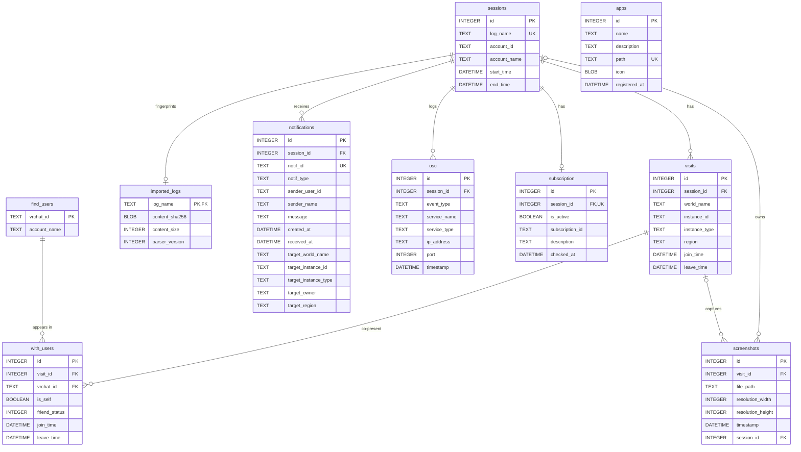

# Database Schema and Data Storage

SQLiteのschemaと、ログ本文・設定・運用データの保存契約を記述する。

## Document Control

| Field              | Content                                                                                                                                                                       |
| ------------------ | ----------------------------------------------------------------------------------------------------------------------------------------------------------------------------- |
| Application        | StellaRecord                                                                                                                                                                  |
| Scope              | 保存先、形式、識別、transaction、初期化、削除、保全。操作条件はspec、実行主体はarchitectureを参照する                                                                         |
| Audience           | データを変更・参照する開発者、backupや削除範囲を確認する人                                                                                                                    |
| Authority          | `src-tauri/src/analyze/db.rs`（MAIN_SCHEMA / MAIN_VIEWS）、`analyze/mod.rs`、`commands/archive.rs`、`config.rs`、`utils.rs`（同じsrc配下）、`src-tauri/windows/installer.nsi` |
| Related documents  | [README](../README.md)、[Specification](spec.md)、[Architecture](architecture.md)、[Tech Stack](tech-stack.md)、[Operation Preview](manual.html)                              |
| Source review date | 2026-10-23（sourceとの静的照合日。実行試験日ではない）                                                                                                                        |

## Table of Contents

- [Storage and Ownership](#storage-and-ownership)
- [Records and Keys](#records-and-keys)
- [Relationships](#relationships)
- [Tables and Views](#tables-and-views)
- [Indexes and Query Semantics](#indexes-and-query-semantics)
- [Write Transactions and Invariants](#write-transactions-and-invariants)
- [Initialization and Compatibility](#initialization-and-compatibility)
- [Deletion and Retention](#deletion-and-retention)
- [Backup and Restore](#backup-and-restore)
- [References](#references)

## Storage and Ownership

| Resource           | Owner                                     | Location and Format                                                               | Identity                            | Write unit                                            | Retention and deletion                                                |
| ------------------ | ----------------------------------------- | --------------------------------------------------------------------------------- | ----------------------------------- | ----------------------------------------------------- | --------------------------------------------------------------------- |
| 元ログ             | 指定した読込元をStellaが読取り・明示削除  | SourceLogPath、未指定時はPolarisのInstallLocation/Data/archive/`output_log_*.txt` | filenameと本文bytes                 | file単位                                              | 同期では保持。一致した元ログの明示削除だけが削除する                  |
| 圧縮archive        | Stella archive command                    | 実効archive directoryの`output_log_*.txt.tar.zst`                                 | 外名と先頭entry名/本文              | 1ログ1entry、一時fileから配置/置換                    | 自動世代削除なし。通常uninstallで保持                                 |
| SQLite / WAL / SHM | 解析とapps登録が書込み、preview等が読取り | 実効DB path、SQLite 3                                                             | log_name/本文指紋、tableのkey       | 解析outer transaction/file savepoint、appsは独立write | 通常uninstallでWAL/SHMを含めて保持。解析部分のみarchiveから再生成可能 |
| Stella registry    | installer/config/settings                 | HKCU/Software/CosmoArtsStore/StellaRecord                                         | 下記value名                         | value単位、管理設定は順次write                        | 通常uninstallでkey全体を保持し、再導入で保存先・設定を引き継ぐ        |
| Polaris共有設定    | PolarisとStella settings                  | HKCU/Software/CosmoArtsStore/Polaris                                              | ArchivePath、CapacityThresholdBytes | value単位                                             | Stellaの通常uninstallはこのkeyを削除しない                            |
| Windows Run        | settings/platform、installer              | HKCUのRun keyのStellaRecord                                                       | value名                             | quoted実行pathの登録/削除                             | 通常uninstallで削除。再導入時は保存済みの有効設定に従って登録         |
| テーマ             | Frontend theme model                      | localStorage stella-record-theme                                                  | light/dark                          | 変更ごと                                              | WebView profile内。DB/archive copyの対象外                            |
| 運用ログ           | utils logger                              | InstallLocation/Data/logs/info-YYYY-MM.log                                        | 月次filename                        | WARN/ERRORをappend                                    | 自動世代削除なし。通常uninstallでも保持。本文/設定のbackupではない    |
| WebView data       | WebView2 runtime                          | InstallLocation/Data/EBWebView                                                    | profile                             | runtime管理                                           | 固定profileとbundle data pathsを通常uninstallでも保持                 |
| 一時状態           | React hook/view、Rust worker              | メモリ、archive生成中の一時file                                                   | 世代/session、running/cancel        | worker/画面の寿命                                     | job継続checkpointなし。生成完了・検証後に一時fileをrename             |

### Location Resolution

Stellaのarchiveは非空ArchivePath、DBは非空DbPathを優先し、未指定時はStellaのInstallLocation/Data/archiveとInstallLocation/Data/db/stellarecord.dbを使う。正本は`src-tauri/src/config.rs`のget_effective_archive_dir/get_effective_db_path。現在のexeの位置から推測しない。overrideもInstallLocationもなければ保存先を解決できず、対応する操作が失敗する。

入力はStella registryの非空SourceLogPathを優先し、未指定時はPolarisのInstallLocation/Data/archiveを組み立てる。Polaris ArchivePathは入力元のfallbackにしない。読込元は設定画面・初回取込確認から変更できる。get_db_pathは親directoryを作成し得る。previewが読取り専用画面であることは、SQLite read-only flagやfilesystem無変更を意味しない。

WebViewはInstallLocationを取得できる場合に上記profileを指定する。取得できない場合、app側で同じ固定pathを指定する処理はない。

### Overview

| Property          | Value                                           |
| ----------------- | ----------------------------------------------- |
| Engine            | SQLite 3 (via rusqlite 0.38, `bundled` feature) |
| Journal Mode      | WAL (Write-Ahead Logging)                       |
| Foreign Keys      | Enforced (`PRAGMA foreign_keys = ON`)           |
| Tables            | 10                                              |
| Views             | 3                                               |
| Indexes           | 11 (UNIQUE 制約による自動生成を除く)            |
| Schema Definition | `src-tauri/src/analyze/db.rs`                   |

データベースは VRChat ログから抽出した正規化データ、取り込み済み本文の識別情報、ランチャー機能で使用する `apps` テーブルで構成される。

## Records and Keys

### Conventions

#### Naming

| Element     | Convention                                                                      | Example                     |
| ----------- | ------------------------------------------------------------------------------- | --------------------------- |
| Table name  | snake_case (複数形)                                                             | `sessions`, `visits`        |
| Column name | snake_case                                                                      | `account_name`, `join_time` |
| Primary key | `id INTEGER PRIMARY KEY AUTOINCREMENT` （`find_users`, `imported_logs` を除く） | -                           |
| Foreign key | `<table>_id INTEGER REFERENCES <table>(id)`。所有関係に応じて `NOT NULL` を付与 | `session_id`                |
| Timestamp   | `DATETIME` 型、`'YYYY-MM-DD HH:MM:SS'` 文字列で保管                             | `join_time`                 |
| Boolean     | `BOOLEAN`（SQLite 内部は INTEGER 0/1）                                          | `is_self`, `is_active`      |
| Enum        | `TEXT CHECK(col IN (...))`                                                      | `instance_type`             |

#### Type Mapping

SQLite はストレージクラスのみを持ち、宣言型は親和性ヒントとして機能する。本プロジェクトでは以下の対応で運用する。

| Declared Type | Storage Class | Rust Type                                    |
| ------------- | ------------- | -------------------------------------------- |
| `INTEGER`     | INTEGER       | `i64`, `u32`                                 |
| `TEXT`        | TEXT          | `String`                                     |
| `DATETIME`    | TEXT          | `String`（`chrono::NaiveDateTime` でパース） |
| `BOOLEAN`     | INTEGER       | `bool`                                       |
| `BLOB`        | BLOB          | `Vec<u8>`                                    |

#### Idempotency

再取り込みやエラー時の冪等性を保証するため、各テーブルで以下の戦略を採用する。

| Table           | Idempotency Mechanism                                                          |
| --------------- | ------------------------------------------------------------------------------ |
| `sessions`      | `log_name UNIQUE`。本文更新時はファイル単位 savepoint 内で関連データごと再構築 |
| `imported_logs` | 展開後本文の SHA-256・バイト長・解析版が一致する場合だけ再取り込みを省略       |
| `notifications` | `notif_id UNIQUE` + `INSERT OR IGNORE`                                         |
| `with_users`    | `UNIQUE(visit_id, vrchat_id)` + `INSERT OR IGNORE`                             |
| `find_users`    | `vrchat_id PRIMARY KEY` + `ON CONFLICT DO UPDATE`（表示名最新化）              |
| `subscription`  | `session_id UNIQUE` + `INSERT OR IGNORE`                                       |
| `apps`          | `path UNIQUE`                                                                  |

### Windows Registry

| Key                                                  | Value Name                   | Type      | Description                               |
| ---------------------------------------------------- | ---------------------------- | --------- | ----------------------------------------- |
| `HKCU\Software\CosmoArtsStore\StellaRecord`          | `InstallLocation`            | REG_SZ    | NSIS が書き込むインストール先             |
| 同上                                                 | `ArchivePath`                | REG_SZ    | アーカイブストア（空ならデフォルト）      |
| 同上                                                 | `DbPath`                     | REG_SZ    | DB ファイル（空ならデフォルト）           |
| 同上                                                 | `SourceLogPath`              | REG_SZ    | ログ読込元（空ならPolarisの既定フォルダ） |
| 同上                                                 | `EnableStartup`              | REG_DWORD | 自動起動 ON/OFF                           |
| 同上                                                 | `StartupPreferenceSet`       | REG_DWORD | Windows自動起動を選択済みか               |
| 同上                                                 | `StartupImportEnabled`       | REG_DWORD | 起動時取込の許可                          |
| 同上                                                 | `StartupImportPreferenceSet` | REG_DWORD | 起動時取込の許可を選択済みか              |
| `HKCU\Software\CosmoArtsStore\Polaris`               | `CapacityThresholdBytes`     | REG_QWORD | アーカイブ警告ライン                      |
| `HKCU\Software\Microsoft\Windows\CurrentVersion\Run` | `StellaRecord`               | REG_SZ    | 自動起動コマンド                          |

### LocalStorage

| Key                   | Value               | Description |
| --------------------- | ------------------- | ----------- |
| `stella-record-theme` | `"light" \| "dark"` | UI テーマ   |

テーマ以外のactive section、list/card、選択、filter、zoom、進捗はメモリのみ。Windows Runの実在値、EnableStartup、起動時取込の許可は別の値である。取込許可の既定はenabled=false、preference_set=false。

## Relationships

### ER Diagram



`apps` テーブルは VRChat ログとは独立しており、ランチャー機能で登録された外部 EXE のメタデータを保管する。

find_usersは複数sessionに共有する最新表示名、appsはログと独立した利用者登録である。session再構築で両者を一括削除しない。row IDは再解析で変わり得るため、外部consumerは恒久的なログ識別子として扱わない。

## Tables and Views

### Tables

#### sessions

ログファイル単位のセッション情報。1 ログファイル = 1 セッション。

| Column         | Type     | Nullable | Default       | Description                                                  |
| -------------- | -------- | -------- | ------------- | ------------------------------------------------------------ |
| `id`           | INTEGER  | NO       | AUTOINCREMENT | プライマリキー                                               |
| `log_name`     | TEXT     | NO       | -             | 元ログファイル名 (例: `output_log_2025-10-21_00-59-15.txt`)  |
| `account_id`   | TEXT     | YES      | NULL          | ログ内の自己アカウントID。複数アカウントを検出した場合はNULL |
| `account_name` | TEXT     | YES      | NULL          | 自己表示名。複数アカウントを検出した場合はNULL               |
| `start_time`   | DATETIME | YES      | NULL          | セッション開始時刻                                           |
| `end_time`     | DATETIME | YES      | NULL          | セッション終了時刻                                           |

**Constraints**

- `PRIMARY KEY (id)`
- `UNIQUE (log_name)` — 再取り込み時に同じログを識別

認証切り替え時に旧訪問を閉じ、各訪問の認証情報・local初期化表示名・入室ユーザーを対応付けて`with_users.is_self`を確定する。1ログに複数アカウントが含まれる場合、sessionsを単一アカウントへ紐付けず、訪問単位のis_selfを参照する。

---

#### imported_logs

取り込み済みログの展開後本文を識別する内部テーブル。同名アーカイブが置き換わった場合でも、本文または解析版が変化したときにセッションと関連データを再構築する。現在の `CURRENT_PARSER_VERSION` は3で、DDLの既定値1は旧取込行の識別に使用する。

| Column           | Type    | Nullable                 | Default | Description                      |
| ---------------- | ------- | ------------------------ | ------- | -------------------------------- |
| `log_name`       | TEXT    | YES（DDLにNOT NULLなし） | -       | 対応する `sessions.log_name`     |
| `content_sha256` | BLOB    | NO                       | -       | 展開後本文の SHA-256（32バイト） |
| `content_size`   | INTEGER | NO                       | -       | 展開後本文のバイト長             |
| `parser_version` | INTEGER | NO                       | 1       | 解析版（現在は3）                |

**Constraints**

- `PRIMARY KEY (log_name)`
- `FOREIGN KEY (log_name) REFERENCES sessions(log_name) ON DELETE CASCADE`
- `CHECK (length(content_sha256) = 32)`
- `CHECK (content_size >= 0)`
- `CHECK (parser_version >= 1)`

---

#### visits

ワールドインスタンスへの 1 回の訪問。`Joining` 行で INSERT、`OnLeftRoom` または次の `Entering Room` で `leave_time` を UPDATE する。

| Column          | Type     | Nullable | Default       | Description                                    |
| --------------- | -------- | -------- | ------------- | ---------------------------------------------- |
| `id`            | INTEGER  | NO       | AUTOINCREMENT | プライマリキー                                 |
| `session_id`    | INTEGER  | NO       | -             | 親セッション (`sessions.id`)                   |
| `world_name`    | TEXT     | NO       | -             | ワールド表示名                                 |
| `instance_id`   | TEXT     | NO       | -             | インスタンス番号                               |
| `instance_type` | TEXT     | YES      | NULL          | 公開区分                                       |
| `region`        | TEXT     | YES      | NULL          | サーバリージョン (`jp`, `use`, `usw`, `eu` 等) |
| `join_time`     | DATETIME | NO       | -             | 入室時刻                                       |
| `leave_time`    | DATETIME | YES      | NULL          | 退室時刻 (滞在中は NULL)                       |

**Constraints**

- `PRIMARY KEY (id)`
- `FOREIGN KEY (session_id) REFERENCES sessions(id)`
- `CHECK (instance_type IN ('private','friends','hidden','public','group') OR instance_type IS NULL)`

**Indexes**

- `idx_visits_join_time (join_time)` — DB プレビューのデフォルトソート
- `idx_visits_session_id (session_id)` — `visit_summary` ビューの集計用

**`instance_type` の値**

VRChat ログの生ラベルをそのまま格納する（ログ忠実保存方針、表示マッピングは消費側 UI の責務）。

| 格納値    | VRChat UI 上の表示                        |
| --------- | ----------------------------------------- |
| `public`  | Public                                    |
| `friends` | Friends                                   |
| `hidden`  | **Friends+** (フレンドのフレンドも参加可) |
| `private` | Invite / Invite+                          |
| `group`   | Group                                     |

同テーブル `notifications.target_instance_type` も同じ値域・同じ生ラベル方針。

---

#### find_users

これまでに観測した VRChat ユーザーのカタログ。

| Column         | Type | Nullable                 | Default | Description           |
| -------------- | ---- | ------------------------ | ------- | --------------------- |
| `vrchat_id`    | TEXT | YES（DDLにNOT NULLなし） | -       | VRChat ID (`usr_xxx`) |
| `account_name` | TEXT | NO                       | -       | 最新観測の表示名      |

**Constraints**

- `PRIMARY KEY (vrchat_id)`

**Notes**

- INSERT 時は `ON CONFLICT(vrchat_id) DO UPDATE SET account_name = excluded.account_name` で表示名を最新化する。

---

#### with_users

訪問単位の同席ユーザー記録。

| Column          | Type     | Nullable | Default       | Description                         |
| --------------- | -------- | -------- | ------------- | ----------------------------------- |
| `id`            | INTEGER  | NO       | AUTOINCREMENT | プライマリキー                      |
| `visit_id`      | INTEGER  | NO       | -             | 訪問 (`visits.id`)                  |
| `vrchat_id`     | TEXT     | NO       | -             | プレイヤー (`find_users.vrchat_id`) |
| `is_self`       | BOOLEAN  | NO       | 0             | 自分自身か                          |
| `friend_status` | INTEGER  | NO       | 2             | 0=非フレンド、1=フレンド、2=不明    |
| `join_time`     | DATETIME | NO       | -             | 観測開始時刻                        |
| `leave_time`    | DATETIME | YES      | NULL          | 観測終了時刻                        |

**Constraints**

- `PRIMARY KEY (id)`
- `FOREIGN KEY (visit_id) REFERENCES visits(id)`
- `FOREIGN KEY (vrchat_id) REFERENCES find_users(vrchat_id)`
- `UNIQUE (visit_id, vrchat_id)` — 同訪問内の重複防止
- `CHECK (friend_status IN (0,1,2))`

フレンド状態は訪問単位のログ証拠から保存する。判定条件は [Specification](spec.md#friend-status) を参照する。

**Indexes**

- `idx_with_users_visit_id (visit_id)`
- `idx_with_users_vrchat_id (vrchat_id)`

---

#### notifications

VRChat の通知履歴。`is_collectible_notification()` でフィルタされた 5 種類のみを格納する。

| Column                 | Type     | Nullable | Default       | Description                    |
| ---------------------- | -------- | -------- | ------------- | ------------------------------ |
| `id`                   | INTEGER  | NO       | AUTOINCREMENT | プライマリキー                 |
| `session_id`           | INTEGER  | NO       | -             | 受信セッション                 |
| `notif_id`             | TEXT     | YES      | NULL          | VRChat 側の通知 ID (`not_xxx`) |
| `notif_type`           | TEXT     | NO       | -             | 通知種別                       |
| `sender_user_id`       | TEXT     | YES      | NULL          | 送信者の VRChat ID             |
| `sender_name`          | TEXT     | YES      | NULL          | 送信者表示名                   |
| `message`              | TEXT     | YES      | NULL          | 通知本文                       |
| `created_at`           | DATETIME | YES      | NULL          | 通知元での生成時刻             |
| `received_at`          | DATETIME | NO       | -             | アプリでの観測時刻             |
| `target_world_name`    | TEXT     | YES      | NULL          | 招待先ワールド名               |
| `target_instance_id`   | TEXT     | YES      | NULL          | 招待先インスタンス ID          |
| `target_instance_type` | TEXT     | YES      | NULL          | 招待先公開区分                 |
| `target_owner`         | TEXT     | YES      | NULL          | 招待先インスタンスオーナー     |
| `target_region`        | TEXT     | YES      | NULL          | 招待先リージョン               |

**Constraints**

- `PRIMARY KEY (id)`
- `FOREIGN KEY (session_id) REFERENCES sessions(id)`
- `UNIQUE (notif_id)`
- `CHECK (notif_type IN ('boop','friendRequest','requestInvite','invite','group'))`

**Indexes**

- `idx_notifications_type (notif_type)`
- `idx_notifications_received (received_at)`

---

#### screenshots

VRChat Camera による撮影イベント。

| Column              | Type     | Nullable | Default       | Description                            |
| ------------------- | -------- | -------- | ------------- | -------------------------------------- |
| `id`                | INTEGER  | NO       | AUTOINCREMENT | プライマリキー                         |
| `visit_id`          | INTEGER  | YES      | NULL          | 撮影時の訪問 (ワールド外撮影時は NULL) |
| `file_path`         | TEXT     | NO       | -             | 保存先フルパス                         |
| `resolution_width`  | INTEGER  | YES      | NULL          | 解像度幅 (px)                          |
| `resolution_height` | INTEGER  | YES      | NULL          | 解像度高さ (px)                        |
| `timestamp`         | DATETIME | NO       | -             | 撮影時刻                               |
| `session_id`        | INTEGER  | YES      | NULL          | 取り込み元セッション (`sessions.id`)   |

**Constraints**

- `PRIMARY KEY (id)`
- `FOREIGN KEY (visit_id) REFERENCES visits(id)`
- `FOREIGN KEY (session_id) REFERENCES sessions(id)`

**Indexes**

- `idx_screenshots_visit_id (visit_id)`
- `idx_screenshots_timestamp (timestamp)`
- `idx_screenshots_session_id (session_id)`

取り込みでは、ワールド外撮影を含む全行に `session_id` を保存する。旧スキーマへの列追加や所有元の自動補完は行わない。

---

#### osc

OSC サービス検出イベント。`Found new OSC Service: <name> at <ip>:<port>` 行から抽出する。

| Column         | Type     | Nullable | Default       | Description                            |
| -------------- | -------- | -------- | ------------- | -------------------------------------- |
| `id`           | INTEGER  | NO       | AUTOINCREMENT | プライマリキー                         |
| `session_id`   | INTEGER  | NO       | -             | 検出セッション                         |
| `event_type`   | TEXT     | NO       | -             | イベント種別                           |
| `service_name` | TEXT     | YES      | NULL          | サービス名 (例: `OyasumiVR`)           |
| `service_type` | TEXT     | YES      | NULL          | OSC / OSCQuery 区別 (現状は NULL 固定) |
| `ip_address`   | TEXT     | YES      | NULL          | 検出時の接続先 IP                      |
| `port`         | INTEGER  | YES      | NULL          | ポート番号                             |
| `timestamp`    | DATETIME | NO       | -             | 検出時刻                               |

**Constraints**

- `PRIMARY KEY (id)`
- `FOREIGN KEY (session_id) REFERENCES sessions(id)`
- `CHECK (event_type IN ('found'))`

**Indexes**

- `idx_osc_session_id (session_id)`
- `idx_osc_timestamp (timestamp)`

---

#### subscription

VRChat+ サブスクリプション状態。セッション開始時に 1 回出力される `Get VRChat Subscription Details!` 行から抽出する。

| Column            | Type     | Nullable | Default       | Description                |
| ----------------- | -------- | -------- | ------------- | -------------------------- |
| `id`              | INTEGER  | NO       | AUTOINCREMENT | プライマリキー             |
| `session_id`      | INTEGER  | NO       | -             | 確認セッション             |
| `is_active`       | BOOLEAN  | NO       | -             | VRChat+ 有効フラグ         |
| `subscription_id` | TEXT     | YES      | NULL          | VRChat 側の契約 ID         |
| `description`     | TEXT     | YES      | NULL          | サブスクリプション種別説明 |
| `checked_at`      | DATETIME | NO       | -             | 確認時刻                   |

**Constraints**

- `PRIMARY KEY (id)`
- `FOREIGN KEY (session_id) REFERENCES sessions(id)`
- `UNIQUE (session_id)` — 1 セッション 1 レコード

---

#### apps

ランチャーに登録された外部 EXE のメタデータ。VRChat ログとは独立した管理データ。

| Column          | Type     | Nullable | Default                        | Description           |
| --------------- | -------- | -------- | ------------------------------ | --------------------- |
| `id`            | INTEGER  | NO       | AUTOINCREMENT                  | プライマリキー        |
| `name`          | TEXT     | NO       | -                              | 表示名                |
| `description`   | TEXT     | NO       | `''`                           | 説明文                |
| `path`          | TEXT     | NO       | -                              | EXE のフルパス        |
| `icon`          | BLOB     | YES      | NULL                           | アイコン PNG バイナリ |
| `registered_at` | DATETIME | YES      | `datetime('now', 'localtime')` | 登録時刻              |

**Constraints**

- `PRIMARY KEY (id)`
- `UNIQUE (path)` — 同一 EXE の重複登録防止

---

### Views

#### visit_summary

各訪問の滞在秒数と他プレイヤー数を付与した派生ビュー。

```sql
CREATE VIEW visit_summary AS
SELECT
    v.id AS visit_id,
    v.world_name,
    v.instance_id,
    v.instance_type,
    v.region,
    v.join_time,
    v.leave_time,
    unixepoch(COALESCE(v.leave_time, datetime('now', 'localtime'))) - unixepoch(v.join_time)
      AS duration_sec,
    (SELECT COUNT(*)
     FROM with_users wu
     WHERE wu.visit_id = v.id AND wu.is_self = 0) AS other_player_count
FROM visits v
ORDER BY v.join_time DESC;
```

| Column               | Type     | Description                                                 |
| -------------------- | -------- | ----------------------------------------------------------- |
| `visit_id`           | INTEGER  | `visits.id`                                                 |
| `world_name`         | TEXT     | ワールド名                                                  |
| `instance_id`        | TEXT     | インスタンス ID                                             |
| `instance_type`      | TEXT     | 公開区分                                                    |
| `region`             | TEXT     | リージョン                                                  |
| `join_time`          | DATETIME | 入室時刻                                                    |
| `leave_time`         | DATETIME | 退室時刻                                                    |
| `duration_sec`       | INTEGER  | 滞在秒数 (`leave_time` が NULL の場合は現在のlocaltimeまで) |
| `other_player_count` | INTEGER  | 自分を除いた同席プレイヤー数                                |

---

#### with_users_detail

`with_users` に `find_users` と `visits` を結合した詳細ビュー。

```sql
CREATE VIEW with_users_detail AS
SELECT
    wu.id,
    wu.visit_id,
    v.world_name,
    wu.vrchat_id,
    fu.account_name AS user_name,
    wu.is_self,
    wu.friend_status,
    wu.join_time,
    wu.leave_time
FROM with_users wu
JOIN find_users fu ON fu.vrchat_id = wu.vrchat_id
JOIN visits v ON v.id = wu.visit_id;
```

| Column          | Type     | Description            |
| --------------- | -------- | ---------------------- |
| `id`            | INTEGER  | `with_users.id`        |
| `visit_id`      | INTEGER  | 訪問 ID                |
| `world_name`    | TEXT     | ワールド名             |
| `vrchat_id`     | TEXT     | プレイヤー VRChat ID   |
| `user_name`     | TEXT     | プレイヤー表示名       |
| `is_self`       | BOOLEAN  | 自分自身か             |
| `friend_status` | INTEGER  | 訪問時点のフレンド状態 |
| `join_time`     | DATETIME | 観測開始時刻           |
| `leave_time`    | DATETIME | 観測終了時刻           |

---

#### screenshots_detail

`screenshots` に `visits` を LEFT JOIN した詳細ビュー（ワールド外撮影に対応するため LEFT JOIN）。

```sql
CREATE VIEW screenshots_detail AS
SELECT
    s.id,
    s.visit_id,
    v.world_name,
    s.file_path,
    s.resolution_width,
    s.resolution_height,
    s.timestamp
FROM screenshots s
LEFT JOIN visits v ON v.id = s.visit_id;
```

| Column              | Type     | Description                        |
| ------------------- | -------- | ---------------------------------- |
| `id`                | INTEGER  | `screenshots.id`                   |
| `visit_id`          | INTEGER  | 訪問 ID (NULL 可)                  |
| `world_name`        | TEXT     | ワールド名 (ワールド外撮影は NULL) |
| `file_path`         | TEXT     | 保存先フルパス                     |
| `resolution_width`  | INTEGER  | 解像度幅                           |
| `resolution_height` | INTEGER  | 解像度高さ                         |
| `timestamp`         | DATETIME | 撮影時刻                           |

## Indexes and Query Semantics

### Indexes

UNIQUE 制約による自動生成インデックスを除く、明示的に作成されるインデックス一覧。

| Index                        | Table           | Columns       | Purpose                            |
| ---------------------------- | --------------- | ------------- | ---------------------------------- |
| `idx_visits_join_time`       | `visits`        | `join_time`   | DB プレビューのデフォルトソート    |
| `idx_visits_session_id`      | `visits`        | `session_id`  | `visit_summary` ビューの JOIN      |
| `idx_with_users_visit_id`    | `with_users`    | `visit_id`    | `with_users_detail` ビューの JOIN  |
| `idx_with_users_vrchat_id`   | `with_users`    | `vrchat_id`   | プレイヤー単位検索                 |
| `idx_notifications_type`     | `notifications` | `notif_type`  | 通知種別フィルタ                   |
| `idx_notifications_received` | `notifications` | `received_at` | 時系列ソート                       |
| `idx_screenshots_visit_id`   | `screenshots`   | `visit_id`    | `screenshots_detail` ビューの JOIN |
| `idx_screenshots_timestamp`  | `screenshots`   | `timestamp`   | 時系列ソート                       |
| `idx_screenshots_session_id` | `screenshots`   | `session_id`  | 再取り込み時のセッション単位削除   |
| `idx_osc_session_id`         | `osc`           | `session_id`  | セッション JOIN                    |
| `idx_osc_timestamp`          | `osc`           | `timestamp`   | 時系列ソート                       |

### Read Performance

previewは表示metadata登録の9テーブル/3ビューを対象とし、内部imported_logsは一覧に含めない。LIMIT 500 OFFSETでページ取得し、指定sortまたはtableごとのdefault_sortを使う。NULLはNULL、BLOBは`<BLOB>`文字列として返す。

viewは非実体化で照会時にJOIN/集計する。visit_summaryのleave_time=NULLの滞在秒は照会時localtimeに依存する。with_users_detailの表示名は履歴snapshotではない。screenshots_detailはvisitなしの写真をLEFT JOINで残し、session_idを出力しない。

取得コストは行数/OFFSET/sortによる。WALは未確定writerと確定済みreaderを分離するが、別writer/schema初期化/外部toolとの競合やすべてのSQLITE_BUSYを防ぐ保証はない。

## Write Transactions and Invariants

### Import Identity

archive外名から.tar.zstを除いたlog_nameと、展開した先頭entry本文のSHA-256（32 bytes）/本文長/CURRENT_PARSER_VERSION=3で判定する。tar時刻や圧縮bytes自体ではない。同名別内容は併存せず置換する。先頭entryが通常ファイルでない場合、または本文が宣言サイズより短い場合はファイル単位の取り込み失敗とし、既存の解析結果を保持する。

file savepoint開始後に指紋を計算する。一致ならskip、不一致なら旧session所有のscreenshots/with_users/visits/notifications/osc/subscription/imported_logs/sessionを削除し、解析・指紋登録を行う。file失敗時はsavepointをrollbackし旧確定データを戻す。共有find_users/appsは巻き添え削除しない。

### Import Commit Boundaries

run_diff_import/run_enhanced_import_batchはDB接続とinit_main_dbの後にouter transactionを開始する。schema初期化/互換処理と先行archive同期はouter transactionの外にある。

| Mode and result         | Database result                                     | Other retained effects                          |
| ----------------------- | --------------------------------------------------- | ----------------------------------------------- |
| 手動batch全成功         | 全選択処理後に取消しを最終確認してouter commit      | 既存archiveを変更しない                         |
| 手動batchの通常file失敗 | 当該savepointとouter transactionをrollback          | 起動時同期等の既存archiveは保持                 |
| 差分の通常file失敗      | 当該savepointのみrollback、後続処理後に成功分commit | archive更新は巻き戻さない                       |
| 両方式の取消し          | 今回のouter transaction全体をrollback               | schema初期化、先行archive、元ログ削除は含めない |
| outer/commit失敗        | 成功と扱わず、未確定更新はrollback対象              | 別資源まで戻す契約ではない                      |

fileごとの完了進捗はouter commit前に送る。表示と永続化確定は同義ではない。appsは別接続/別writeであり、取込running flagが全writerを直列化するわけではない。

### Archive Replacement

新規または厳密な追記だけを同期対象とする。同サイズ別内容・縮小・非prefixは旧archive保持。圧縮開始時点の元ログサイズに読取範囲を固定し、tar.finish→zstd.finish→sync_allを明示的に完了する。置換では生成済み本文が既存entryと同名で、既存本文全体をprefixとして保持していることを再確認し、同一directory内のrenameで置き換える。検証・配置に失敗した場合は旧archiveを保持し、一時fileを破棄する。

旧名を先に退避する処理はなく、正規名が一時的に欠落する区間を作らない。複数archive同期の単一transaction/一括rollbackや同期中cancel確認はなく、途中失敗の先行成功fileは残る。

### Settings Writes

管理設定はPolaris設定→Run→Stella設定の順に保存する。途中失敗時はStella→Run→Polarisの順に開始前値の復元を試み、復元失敗もerrorに含める。全registry書込みはatomicではない。

Windows自動起動を切り替える場合は保存済みの警告ラインを保持し、編集中の警告ラインを同時に保存しない。警告ラインは専用の「保存」で確定する。読込元変更は実在する絶対パスとread_dir成功を確認し、SourceLogPathだけを保存する。取消しでは変更しない。

取込許可はStartupImportEnabled→StartupImportPreferenceSetの順に保存し、独自transaction/rollbackはない。tableの競合処理は[Idempotency](#idempotency)を参照する。

## Initialization and Compatibility

### Initialization and PRAGMA

`src-tauri/src/analyze/db.rs::init_main_db` は現行DDLを初版の構成として使用する。空DBと、姉妹アプリが先に作成した現行の `apps` テーブルだけを持つDBを初期化できる。既存DBは物理的な列順に依存せず列名・型・必須指定・主キーを照合し、旧構成や不足した構成は既存DBを変更せずエラーにする。列追加・所有元補完による自動移行は行わない。

受入可能なDBではWALと外部キーを有効にし、`MAIN_SCHEMA` と派生ビュー3件を同じsavepoint内で初期化する。既存のログ解析行とアプリ登録行は保持する。本文・解析版による再解析判定は、DB構成の移行とは別の契約である。

#### Active PRAGMAs

| PRAGMA         | Value | Reason                                                                |
| -------------- | ----- | --------------------------------------------------------------------- |
| `journal_mode` | `WAL` | 取り込み中（書き込み）と読み取り（ビューア・DB プレビュー）の並行動作 |
| `foreign_keys` | `ON`  | REFERENCES 制約の実行時チェック (デフォルト OFF)                      |

DB構成の照合は書込み前に行う。WALと外部キーの設定はsavepoint開始前で、schemaと派生ビューの初期化は同じsavepointを使う。旧構成への列追加・所有元補完・データ削除は行わない。

## Deletion and Retention

| Operation                    | Original input                 | Derived data                                    | User-added data    | Settings                                                   | Partial failure and recovery                                                                                               |
| ---------------------------- | ------------------------------ | ----------------------------------------------- | ------------------ | ---------------------------------------------------------- | -------------------------------------------------------------------------------------------------------------------------- |
| 起動時同期/解析              | 読込元ログ保持                 | archiveをfile単位生成/置換、解析は上記方式      | apps保持           | 保持                                                       | 同期の先行成功は残る。解析とは別に再試行                                                                                   |
| 手動「アーカイブの取り込み」 | 原本/archive保持               | 選択archiveから解析DB再構築                     | apps保持           | 保持                                                       | 全選択成功時commit、取消し/通常file失敗は今回全rollback                                                                    |
| 元ログ削除                   | 確認した読込元の選択対象を削除 | archive/DB保持                                  | apps保持           | 保持                                                       | 候補取得時の読込元を再確認。entry名/size/本文bytesの照合から削除まで同じhandleを保持し、追記・置換を防ぐ。既削除分undoなし |
| 登録解除                     | EXE/対象appデータ保持          | 解析行保持                                      | 該当apps行のみ削除 | 保持                                                       | 復元APIなし。再登録する                                                                                                    |
| /UPDATE                      | 原本/archive保持               | DB・運用ログ・WebView・bundle data保持          | apps保持           | Run/Stella key保持。保存済みのDB/archive参照先を引き継ぐ   | 本体配置情報を更新。有効な自動起動設定は現配置先へ登録。データの自動移動なし                                               |
| 通常uninstall                | 原本/archive保持               | DB・WAL/SHM・運用ログ・WebView・bundle data保持 | apps保持           | Stella/Polaris key保持。RunとWindowsのアプリ一覧登録を削除 | 同梱file・shortcut・uninstallerを削除。必須削除失敗で中断し、先行成功をrollbackしない                                      |
| 再インストール               | 原本/archive保持               | 保存済みDBとarchiveを参照。データの自動移動なし | apps保持           | Stella設定を引き継ぎ、自動起動が有効ならRunを登録          | 明示DbPathは上書きしない。配置先変更時も旧既定のarchive参照先を保存する                                                    |
| 手動backup/restore           | 停止後archive copy             | 停止後DB directory copy                         | appsはDBに含む     | registry/localStorageは別                                  | 稼働中3file順次copyをsnapshotと扱わない                                                                                    |

通常uninstallもinstaller再実行UIも、利用者データと設定を削除しない。installerから既存本体を削除する場合は、子uninstallerへ必ず/UPDATEを渡す。外部DbPath/ArchivePathも保持する。[Installation Lifecycle](tech-stack.md#installation-lifecycle)を参照する。install directoryは空の場合だけ削除する。

### Storage

DB容量はログ内容/訪問/通知/撮影件数による。固定の1session容量は定義しない。容量警告は自動削除/保存拒否上限ではない。自動VACUUM、DB cleanup/reset、全backup/restore UIはない。

## Backup and Restore

### Backup

専用の全データバックアップ API はない。手動コピーでは StellaRecord と同じ DB を開く他のプロセスを終了し、実効 DB directory を残存する `stellarecord.db-wal` / `stellarecord.db-shm` を含めて保全する。稼働中に3ファイルを順次コピーする方法は、一貫した snapshot を保証しない。稼働中の保全が必要な場合は SQLite backup API 等を扱う外部ツールで snapshot を取得する。

### Restore

停止中に archive と DB を実効保存先へコピーする。既定は `Data/archive/` と `Data/db/` だが registry の明示保存先が優先される。registry設定、localStorageのテーマ、WebViewデータは DB backup に含まれない。解析データは保全したアーカイブから再構築できるが、`apps` のランチャー登録はログから再生成できない。

### External Tools

DB ファイルは標準的な SQLite 3 形式のため、以下のツールで直接読み出し可能。

- [`sqlite3`](https://sqlite.org/cli.html) CLI
- [DB Browser for SQLite](https://sqlitebrowser.org/)
- VSCode の SQLite 拡張機能

原本が失われた場合、archiveは本文の唯一の保存物になり得る。解析部分を再生成できてもapps/registry/themeはログから再生成できない。

## References

- [Specification](spec.md): 操作条件と成功/取消し/部分失敗後の再実行。
- [Architecture](architecture.md): 接続とworkerの所有、IPC、排他と終了。
- [Tech Stack](tech-stack.md): 開発command、CI、導入・更新・削除。
